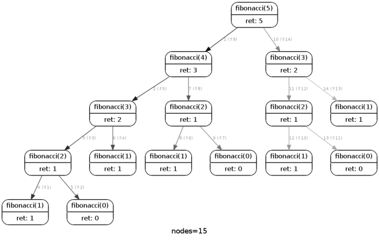

# C Piscine C05

### ex00: `ft_iterative_factorial`

Factorial means for example 5! = 1 * 2 * 3 * 4 * 5.

We define these `int`:
- `i` is the upcoming number
- `n` is the current

We start both `i` and `n` as 1
If `nb` is zero, then return 1.

While `i` which is our next number doesn't equal the number, we increment `i` we multiply `n` by `i` and store it inside `n`

So that would be 1 * 2 for the first iteration, `n` now equals 1 * 2 = 2.
Next iteration, `i` becomes 3, so when we multiply `n` by `i`, where `n` = 1 * 2 and now it's 1 * 2 * 3, 3 coming from `i`. And the next iteration, `i` is four and so on.

This is what is called an iterative approach.
### ex01: `ft_recursive_factorial`

Factorial means for example 5! = 1 * 2 * 3 * 4 * 5.

We first check if `nb` is less than 0, if yes we return 0, and we return 1 if `nb` is 0.

If not, we return our current `nb` * `ft_recursive_factorial` of `nb - 1`

This causes it to multiply starting from the largest number which is the first `nb`, then `nb - 1`, and so every time the function calls itself it multiplies `nb` one less, until we end up with the number.

This is what is called a recursive approach, where the function calls itself to do a small portion of it's own behavior.
### ex02: `ft_iterative_power`

Power in this case means multiplying a number with itself `power` times.

We define these `int`:
- `i` counts how many times we did the multiplication
- `basenum` is the `nb` we start with, since it must stay constant

We start with `i` as 0 and `basenum` with `nb`
If `power` is zero, then return 1. 

While `i` is less than the `power` - 1 (because we start counting from 0, 0 is the first), we increment `i` we multiply `nb` by `basenum` and store it inside `nb`, and we increment `i`

So that would be `nb` * `basenum` for the first iteration, `nb` now equals `nb` squared.
Next iteration, `nb` becomes `nb` * `basenum` which also equals `basenum` * `basenum` * `basenum`, which is why it's `nb` to the power of 3. And the next iteration, `i` is four and so on.

This is what is called an iterative approach.
### ex03: `ft_recursive_power`

Funnily enough, recursive power works the exact same way as recursive factorial, except `power - 1` is passed as power, and `nb` is left in tact.
### ex04: `ft_fibonacci`

Formula for the Fibbonachi sequence is:

$F_n = F_{n-1} + F_{n-2}$

We hardcode that index 0 and 1 stay the same in Fibonacci sequence, because 0 is always 0 and 1 is always 1 in Fibonacci sequence.

The formula already tells us this has to be recursive, so does the exercise, and it's pretty much an insert.

The way this works is imagine that the first call eg. `ft_fibonacci(5)` is a box with 2 boxes inside. Those boxes are `ft_fibonacci(4)` and `ft_fibonacci(3)` respectively.

Inside those boxes are also smaller boxes `ft_fibonacci(2)` and `ft_fibonacci(1)`. Only the value of `ft_fibonacci(1)` and `ft_fibonacci(0)` are known to be 1 and 0 respectively.

So in the end we end up with a row of 1 and 0 resulting from the tree of opening those boxes, and adding these together results in the value of our initial/largest box.

Here's a visualization I found on Google:

Because we need to check if the input is invalid and return 0 in that case, we just check if the number is less than 0 which isn't allowed. That's it.
### ex05: `ft_sqrt`

Instead of trying to calculate the square root, we can just try to go through all, starting from 0 all the way to 46340. Why that number? Because it's the last squared number that would result in a number that is small enough to fit below `INT_MAX`, go higher and it will overflow.
### ex06: `ft_is_prime`

If the number is 0 or 1, then it can't possibly be a prime number, so return 0 there.

Now attempt to divide the number by everything below it except for 1, if you hit one that has no remainders, then it can't be a prime number, since it's not just divisible by itself.

If it's only divisible by 1 or itself, it's a prime number.
### ex07: `ft_get_next_prime`

Use `ft_is_prime` to see if the current number is a prime. If it isn't, increment and try again, until you finally hit a prime number.

### ex08: Ten Queen Puzzle

TODO
